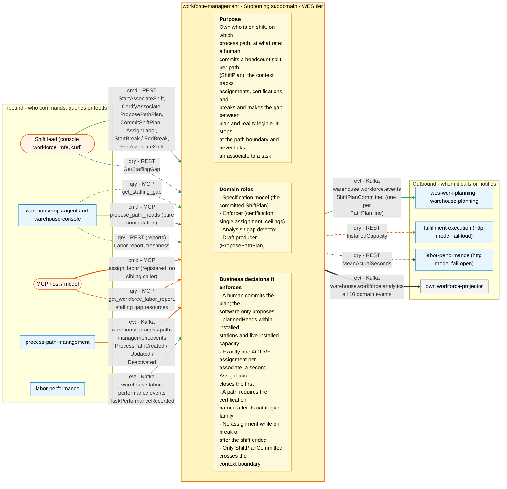

# Bounded context canvas

Follows the ddd-crew
[Bounded Context Canvas v5](https://github.com/ddd-crew/bounded-context-canvas).
Every message row below maps to a real route in
`internal/adapters/inbound/http/router.go` or `reports_handler.go`, an MCP
tool/resource in `internal/adapters/inbound/mcp/`, a Kafka topic + CloudEvents
`type` from `internal/adapters/kafka/cloudevents/types.go`, or an outbound
client under `internal/adapters/outbound/`.

## Canvas at a glance

One picture of the sections below, laid out like the ddd-crew canvas:
inbound collaborators on the left, this context in the middle (purpose,
domain roles and the business decisions it enforces), outbound
collaborators on the right. Arrows follow the message type: **solid blue**
commands (`cmd`), **dotted green** queries (`qry`), **thick orange** events
(`evt`); each arrow names its channel and the messages it carries. Box shapes
mark the collaborator kind: rounded = people, UI or any client; blue =
sibling bounded context; double border = external system or platform;
grey = this context's own projector, reports or dead-letter path; dashed =
published today with no consumer. Channel names on the arrows are
abbreviated (REST, MCP, Kafka, HTTP, port); the Inbound and Outbound
Communication tables carry the exact route, tool, topic and CloudEvents
type for every message.

Source: the Inbound Communication and Outbound Communication tables of this
page, which map to `internal/adapters/inbound/{http,kafka,mcp}` and `internal/adapters/outbound/`. The diagram omits assumptions, verification metrics, open
questions and the ubiquitous language (sections below), the relationship
pattern per message (OHS, ACL, Conformist, Customer/Supplier - see the
tables) and anything the tables mark as deprecated or platform-only
(health probes).

## Name

**Workforce Management** (`workforce-management`). CloudEvents `source`
`/warehouse/workforce-management`, `type` prefix
`com.warehouse.wes.workforce-management.`

## Purpose

Own "who is on shift, on which process path, at what rate; direct vs
indirect hours." A human commits a headcount split across paths at shift
start (`ShiftPlan`); during the shift this context tracks which path each
associate is on (`LaborAssignment`), their certifications and breaks
(`AssociateShift`), and makes the gap between plan and reality legible
(`PathUnderstaffed`). It stops at the **path boundary**: it never links an
associate to a task ([ADR 0002](../adr/0002-stop-at-the-path-boundary.md)),
and it never decides who moves — that is a human call it records.

## Strategic Classification

| Axis | Value | Evidence |
| --- | --- | --- |
| **Domain** | **Supporting** | [Subdomain classification](./subdomain-classification.md), [Core domain chart](./core-domain-chart.md) |
| **Business Model** | **Compliance / cost reduction** — enforces certification gating, single active assignment and capacity ceilings; does not generate revenue or differentiate | the four Definition-of-Done invariants in [Invariants](./invariants.md) |
| **Evolution** | **Product** (industry-common labor allocation), with two custom-built parts: the idle-share trim and the live installed-capacity ceiling | [ADR 0020](../adr/0020-idle-share-staffing-signal.md), [ADR 0014](../adr/0014-installed-capacity-ceiling.md) |

## Domain Roles

- **Specification model** — the committed `ShiftPlan` is the authoritative
  statement of planned heads per path that `wes-work-planning` and
  `warehouse-planning` consume.
- **Enforcer** — rejects an uncertified, on-break, ended-shift or
  over-capacity request; the rules are the point of the context.
- **Analysis / gap detector** — `GetStaffingGap` compares plan against
  active heads (fleet-wide, or one canonical site when `siteCode` is given,
  [ADR 0034](../adr/0034-site-scoped-staffing-gap.md)) and raises
  `PathUnderstaffed` as a flag, never as an action.
- **Draft producer** — `ProposePathPlan` computes a headcount proposal that a
  human may or may not commit.

## Inbound Communication

| Collaborator | Message | Type | Channel | Relationship |
| --- | --- | --- | --- | --- |
| Shift lead (console `workforce_mfe`, curl) | StartAssociateShift | Command | `POST /associates/{id}/start-shift` (optional `siteCode`, [ADR 0034](../adr/0034-site-scoped-staffing-gap.md)) | OHS (REST, OpenAPI) |
| Shift lead | CertifyAssociate | Command | `POST /associates/{id}/certifications` | OHS |
| Shift lead | ProposePathPlan | Command (pure computation; publishes `ShiftPlanProposed`) | `POST /paths/{pathId}/plan/propose` (body `siteCode`, deprecated alias `buildingId`; [ADR 0035](../adr/0035-sitecode-converges-building-id.md)) | OHS |
| Shift lead | CommitShiftPlan | Command | `POST /shift-plans` (requires `Idempotency-Key`; body `siteCode`, deprecated alias `buildingId`) | OHS |
| Shift lead | AssignLabor | Command | `POST /associates/{id}/assignments` (requires `Idempotency-Key`) | OHS |
| Shift lead | StartBreak / EndBreak | Command | `POST /associates/{id}/break/start`, `POST /associates/{id}/break/end` | OHS |
| Shift lead | EndAssociateShift | Command | `POST /associates/{id}/end-shift` | OHS |
| Shift lead, console | GetStaffingGap | Query | `GET /paths/{pathId}/staffing-gap?siteCode=&shiftId=` (deprecated alias `buildingId`: plan lookup only, not scoped), canonical `GET /sites/{siteCode}/shifts/{shiftId}/staffing-gap`, deprecated `GET /buildings/{buildingId}/shifts/{shiftId}/staffing-gap[?siteCode=]` | OHS |
| `warehouse-ops-agent` | get_staffing_gap | Query | MCP tool `get_staffing_gap` (`cmd/mcp`; `siteCode`, deprecated alias `buildingId`) | OHS (MCP) |
| `warehouse-ops-agent` | propose_path_heads | Command (pure computation) | MCP tool `propose_path_heads` (`siteCode`, deprecated alias `buildingId`) | OHS (MCP) |
| MCP host / model | assign_labor | Command | MCP tool `assign_labor` (registered; no sibling calls it in code today) | OHS (MCP) |
| MCP host / model | get_workforce_labor_report | Query | MCP tool `get_workforce_labor_report` (only when `REPORTS_BASE_URL` is set) | OHS (MCP) |
| MCP host / model | staffing gap | Query | MCP resources `staffing://sites/{siteCode}/{shiftId}/{pathId}/gap` (canonical, scoped) and deprecated `staffing://{buildingId}/{shiftId}/{pathId}/gap` (unscoped) | OHS (MCP) |
| `warehouse-ops-agent`, `warehouse-console` | Labor report | Query | `GET /reports/labor`, `GET /reports/labor/freshness` (`cmd/workforce-reports`) | OHS (REST) |
| `process-path-management` | ProcessPathCreated / Updated / Deactivated | Event | `warehouse.process-path-management.events`, `com.warehouse.wes.process-path-management.processpath.ProcessPath{Created,Updated,Deactivated}` (only when `PATH_CATALOGUE_SOURCE=kafka`) | CF on its Published Language |
| `labor-performance` | TaskPerformanceRecorded | Event | `warehouse.labor-performance.events`, `com.warehouse.wes.labor-performance.performance.TaskPerformanceRecorded` (only when `LABOR_PERFORMANCE_MODE=kafka-cache`) | CF + ACL (`taskTypeForPathId`) |
| this context (`cmd/workforce-projector`) | 8 analytics events | Event | `warehouse.workforce.analytics`, group `workforce-analytics` | internal (own data product) |

## Outbound Communication

| Collaborator | Message | Type | Channel | Relationship |
| --- | --- | --- | --- | --- |
| `wes-work-planning`, `warehouse-planning` | ShiftPlanCommitted (one per `PathPlan` line) | Event | `warehouse.workforce.events`, `com.warehouse.wes.workforce-management.shiftplan.ShiftPlanCommitted`, key `<siteCode>/<shiftId>` (unchanged; payload carries `site_code` and the deprecated `building_id`) | C/S, PL (customers translate) |
| this context's analytics projector | all 10 domain events | Event | `warehouse.workforce.analytics` | internal |
| `fulfillment-execution` | InstalledCapacity | Query | `GET /capacity/{capability}` (only when `INSTALLED_CAPACITY_MODE=http`; fail-loud) | CF |
| `labor-performance` | MeanActualSeconds | Query | `GET /task-types/{taskType}/performance` (only when `LABOR_PERFORMANCE_MODE=http`; fail-open) | CF + ACL |

## Ubiquitous Language

Full glossary: [Ubiquitous language](../business-context/ubiquitous-language.md).
Top terms: **ShiftPlan**, **PathPlan**, **AssociateShift**,
**LaborAssignment**, **Certification**, **Interval**, **PathUnderstaffed**,
**installed stations** vs **installed capacity**, **Capability**,
**charge**, **planned rate**.

## Business Decisions

- A human commits the plan; the software only proposes
  (`ProposePathPlan` persists nothing).
- `plannedHeads ≤ installedStations` (caller-supplied) **and**
  `plannedHeads ≤ live installed capacity` (from `fulfillment-execution`) —
  two independent ceilings; a missing live entry is a ceiling of 0.
- `plannedHours ≤ plannedHeads × MAX_HOURS_PER_SHIFT` (default 8).
- Exactly one ACTIVE assignment per associate — enforced by construction: a
  second `AssignLabor` closes the first and raises `LaborReassigned`.
- A path requires the certification named after its catalogue family's
  `MatchPrefix` ([ADR 0009](../adr/0009-hazmat-certification-via-existing-path-gating.md),
  [ADR 0013](../adr/0013-process-path-catalogue-validation.md)).
- No assignment while on break or after the shift ended; logged hours may
  not exceed `MAX_HOURS_PER_SHIFT`.
- Committing fails loud when capacity cannot be verified (503); a proposal
  fails open when no measured rate or idle share is available.
- Only `ShiftPlanCommitted` crosses the context boundary; individual moves
  (`LaborAssigned`/`LaborReassigned`) never do.

## Assumptions

- Process-path ids are recognised by case-insensitive prefix family
  (`pick`, `PICK`, `pick-zone-a`), the same rule `fulfillment-execution` and
  `wes-work-planning` apply to the same catalogue.
- Every path declares at least one `requiredCapabilities` entry; a path with
  none gets a capacity ceiling of 0 (defensive, fail-closed).
- `installedStations` in the commit request is truthful — this context cannot
  verify it, which is why the live ceiling exists.
- Associate identity is supplied by the caller; there is no roster
  authority upstream of `StartAssociateShift`.

## Verification Metrics

- `workforce.labor_assignments` counter (accepted / rejected, by path and
  closed-set reason: `uncertified`, `on_break`, `shift_ended`,
  `max_hours_exceeded`, `associate_not_found`, `internal_error`) —
  `ports.LaborMetrics`, [ADR 0015](../adr/0015-standard-metrics-convention.md).
- Outbox lag gauge registered by `postgres.RegisterOutboxLagGauge`
  ([ADR 0016](../adr/0016-transactional-outbox.md)).
- Labor-report freshness lag, `GET /reports/labor/freshness`
  ([ADR 0010](../adr/0010-analytical-data-product.md)).
- Rate of `PathUnderstaffed` per path (`labor_rollup.understaffing_events`).

## Open Questions

- Should `PathUnderstaffed` ever leave the process on the integration topic,
  or stay a read-model flag? Today it is analytics-only
  ([Domain events](./domain-events.md)).
- The measured-rate fallback feeds `meanActualSeconds` (seconds per task),
  converted to a per-head hourly rate (`3600 / seconds`, one task is one unit
  of charge) into the same `ceil(charge / plannedRate)` arithmetic
  as a caller's rate ([ADR 0033](../adr/0033-docs-audit-corrections-2026-10.md)).
  **Verified 2026-10-06 (resolved, no longer open):** in wes-work-planning a
  `WorkUnit` carries no quantity (`id`, `pathId`, `cpt`, `reference`, `sku`,
  `giftWrap`, state, timestamps); one `WorkReleased` makes
  fulfillment-execution's Kafka consumer call `CreateTask` exactly once
  (`internal/adapters/inbound/kafka/consumer.go`); and the charge forecast's
  quantity counts those units. So 1 work unit = 1 task = 1 unit of charge and
  `3600 / MeanActualSeconds` is correct — no unit factor is needed (ADR 0033
  is unchanged).
- **Decided 2026-10-06 — staffing gap by site (resolved, [ADR 0034](../adr/0034-site-scoped-staffing-gap.md)):**
  the gap used to count active assignments across every building. It is now
  optionally scoped to a canonical site (`siteCode`); unscoped callers and
  legacy rows behave as before.
- **Decided 2026-10-06 — `siteCode` converges `buildingId` (resolved, [ADR 0035](../adr/0035-sitecode-converges-building-id.md)):**
  two identifiers for one concept is a ubiquitous-language defect. `siteCode`
  is now the canonical name of the ShiftPlan key on every REST, MCP and event
  surface; `buildingId` is a deprecated alias with the same value and the same
  stored column (no migration, no Kafka key change, nothing removed). A call
  that gives only the legacy `buildingId` is not scoped by site. Removing
  `buildingId` is a later breaking ADR. This replaces the former "buildingId vs
  siteCode are not mapped" note.
- **Decided 2026-10-06 — `domain_event` table:** legacy, unused; retained
  (additive migrations only; dropping needs explicit approval).
- `PathDefinition.DestinationLocationRole` is carried from
  `process-path-management` but nothing here branches on it yet.
- `cmd/mcp` keeps per-process MCP session state, so it is not horizontally
  scalable ([ADR 0024](../adr/0024-horizontal-autoscaling-and-pgxpool-tuning.md)).
